# LSTM Chinese–English Translation

English | [简体中文](README.zh-CN.md)

An English-to-Chinese neural machine translation model built with PyTorch. The encoder is a two-layer bidirectional LSTM, the decoder is a two-layer unidirectional LSTM with additive attention, and training uses teacher forcing. Everything lives in a single Jupyter notebook, so the whole pipeline — data cleaning, vocabulary building, model definition, training, inference and checkpoint saving — can be read top to bottom.

The project is small on purpose. It is meant as a readable reference for how a classic Seq2Seq + attention translator works, not as a production translation service.

## Overview

```mermaid
flowchart LR
    A["data.xls<br/>EN-ZH pairs"] --> B["Text cleaning<br/>regex for EN, jieba for ZH"]
    B --> C["Vocabulary<br/>min freq 2, max 50k"]
    C --> D["Dataset and DataLoader<br/>batch 64, pad plus lengths"]
    D --> E["BiLSTM encoder<br/>2 layers, hidden 512"]
    E --> F["Attention decoder<br/>additive attention, teacher forcing 0.5"]
    F --> G["CrossEntropy loss<br/>ignore pad index"]
    G --> H["best_model.pth<br/>weights plus both vocabularies"]
    H --> I["Greedy decoding<br/>translate"]
```



## Technical Details

- Encoder: `nn.LSTM` with `bidirectional=True`; forward and backward final states are concatenated, then projected back to 512 dimensions by two linear layers so the decoder receives a square hidden state.
- Attention: additive (Bahdanau-style). The decoder's top-layer hidden state is repeated across the source length, concatenated with every encoder output, passed through `tanh` and a linear layer, then softmaxed. Padding positions are masked with `-1e10`.
- Decoder: at each step the input is `[embedding; context]` (256 + 512 = 768 dims). The output state is concatenated with the context vector before the final projection to the target vocabulary.
- Data: English is lowercased and stripped of everything except `a-z0-9`; Chinese is segmented with jieba. Sentences with an empty side are dropped.
- Padding: sequences are packed with `pack_padded_sequence`, so the encoder does not read padding. The loss ignores index 0 (`<PAD>`).
- Checkpointing: the model with the lowest validation loss is written to `best_model.pth` together with both vocabularies.

## Model Configuration

| Parameter | Value |
| --- | --- |
| Embedding dimension | 256 |
| Hidden dimension | 512 |
| LSTM layers | 2 (encoder bidirectional, decoder unidirectional) |
| Dropout | 0.3 |
| Batch size | 64 |
| Learning rate | 0.001 (Adam) |
| Epochs | 15 |
| Teacher forcing ratio | 0.5 |
| Gradient clipping | 1.0 |
| Minimum word frequency | 2 |
| Maximum vocabulary size | 50,000 |
| Trainable parameters | 29,846,112 |

## Project Structure

```
LSTM-chinese_english_translation/
├── LSTM-机器翻译.ipynb     # full pipeline: data, model, training, inference
├── data.xls                # English-Chinese parallel corpus (comma-separated text)
├── DATA_LICENSE.md         # dataset license and attribution
├── LICENSE                 # MIT license for the code
├── README.md               # English documentation (this file)
└── README.zh-CN.md         # Chinese documentation
```

## Getting Started

### Dependencies


```bash
pip install torch numpy pandas jieba tqdm jupyter
```

A CUDA-capable GPU is optional. The notebook falls back to CPU automatically, but training 29M parameters on CPU is slow. The recorded run used a Kaggle Tesla T4.

### Run the notebook

1. Clone the repository and open `LSTM-机器翻译.ipynb`.
2. Change `DATA_PATH` to the local copy of the corpus. The notebook ships with a Kaggle path (`/kaggle/input/...`); replace it with:

   ```python
   DATA_PATH = './data.xls';
   ```

3. Run all cells in order. Data loading, encoding and dataset splitting are handled in the first few cells, then the model is defined, trained and tested.

The notebook writes `best_model.pth` in the current directory and, in the final cell, `final_model.pth` under `/kaggle/working`. Adjust the second path if you are not running on Kaggle.

### Translate a sentence

```python
checkpoint = torch.load('best_model.pth', map_location=device);
src_vocab = checkpoint['src_vocab'];
tgt_vocab = checkpoint['tgt_vocab'];
model.load_state_dict(checkpoint['model_state_dict']);
translate_sentence(model, "How are you", src_vocab, tgt_vocab)
```

`translate_sentence` is defined in the notebook, so call it after training or after rebuilding the model and loading a checkpoint. It decodes greedily: take the most likely token each step, stop at `<EOS>`, cap at 50 steps.

## Dataset

`data.xls` is a comma-separated file (despite the extension) with two columns and no header: English in column 0, Chinese in column 1. After filtering it yields 29,155 sentence pairs, an English vocabulary of 4,425 words and a Chinese vocabulary of 6,496 words at minimum frequency 2. The notebook splits it 70/30 into 20,408 training and 8,747 validation pairs.

Source: [translationcmn3](https://www.kaggle.com/datasets/thespringcomes/translationcmn3) on Kaggle. The sentence pairs originate from the [Tatoeba](https://tatoeba.org) project and are released under CC-BY 2.0 (France). See [DATA_LICENSE.md](DATA_LICENSE.md) for the full attribution.

## Training Notes

Logged losses from the recorded run:

| Epoch | Train loss | Val loss |
| --- | --- | --- |
| 1 | 4.8642 | 5.7000 |
| 2 | 3.9991 | 5.3063 |
| 3 | 3.3249 | 5.1411 |
| 4 | 2.6959 | 5.1429 |
| 5 | 2.1817 | 5.0742 |
| 6 | 1.7938 | 5.2847 |
| 7 | 1.6558 | — (interrupted) |

The run was stopped manually during epoch 7, so the checkpoint behind these logs is undertrained. The validation loss plateaus around 5.1 while the training loss keeps falling — the model starts memorizing the training set. Expect short, loosely related outputs from that checkpoint; the test cell reproduces this.

Things worth trying if you want usable translations:

- Train the full 15 epochs and compare against the epoch-5 checkpoint, which had the lowest validation loss.
- Add a learning-rate scheduler and reduce the learning rate after the validation loss stops improving.
- Replace teacher forcing with a scheduled ratio (start at 1.0, decay per epoch) so early training is more stable.
- Train on a larger corpus. With 29k pairs, an LSTM translator can only learn frequent, short sentence patterns.

## Contributing

Issues and pull requests are welcome. Keep changes focused: this repository is a teaching example, so readability matters more than adding features. If you change the model or the preprocessing, please include the resulting loss curve or a few sample translations in the pull request so the effect is visible.

When reporting a problem, include your Python and PyTorch versions, whether CUDA was used, and the error output or the sentence that translated badly.

## Author

**Ailan Anjuxi (谙弆悕博士)**

- Email: anjuxi.ME@outlook.com
- SIP: sip:anjuxi@sip.linphone.org

Code is released under the MIT license. The dataset keeps its own license — see [DATA_LICENSE.md](DATA_LICENSE.md). For learning and research use only.
