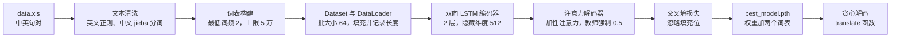

# LSTM 中英翻译

[English](README.md) | 简体中文

基于 PyTorch 的英译中神经机器翻译模型。编码器是两层双向 LSTM，解码器是两层单向 LSTM 并带加性注意力，训练时使用教师强制。全部代码放在一个 Jupyter Notebook 里，从数据清洗、词表构建、模型定义、训练、推理到保存权重，按顺序一路读下来就能看懂。

项目刻意做得很小，它的定位是经典 Seq2Seq + 注意力的可读范例，不是能直接上线的翻译服务。

## 整体流程



## 技术细节

- 编码器：`nn.LSTM` 使用 `bidirectional=True`。前向和后向的最终状态拼接后，由两个线性层投影回 512 维，这样解码器拿到的是形状规整的隐藏状态和细胞状态。
- 注意力：加性注意力（Bahdanau 式）。解码器顶层隐藏状态按源句长度复制，与每个编码器输出拼接，过 `tanh` 和线性层后做 softmax。填充位置用 `-1e10` 掩掉。
- 解码器：每一步的输入是 `[词向量; 上下文向量]`（256 + 512 = 768 维）。LSTM 输出再与上下文拼接，才送入映射到目标词表的线性层。
- 数据处理：英文转小写并去掉 `a-z0-9` 之外的字符；中文用 jieba 分词。任意一侧为空的句子直接丢弃。
- 填充处理：序列用 `pack_padded_sequence` 打包，编码器不会读入填充位；损失函数忽略索引 0（`<PAD>`）。
- 检查点：验证损失最低的那一轮权重会连同两个词表一起写入 `best_model.pth`。

## 模型参数

| 参数 | 取值 |
| --- | --- |
| 嵌入维度 | 256 |
| 隐藏维度 | 512 |
| LSTM 层数 | 2（编码器双向，解码器单向） |
| Dropout | 0.3 |
| 批大小 | 64 |
| 学习率 | 0.001（Adam） |
| 训练轮数 | 15 |
| 教师强制比例 | 0.5 |
| 梯度裁剪 | 1.0 |
| 最低词频 | 2 |
| 词表上限 | 50,000 |
| 可训练参数量 | 29,846,112 |

## 项目结构

```
LSTM-chinese_english_translation/
├── LSTM-机器翻译.ipynb     # 完整流程：数据、模型、训练、推理
├── data.xls                # 中英平行语料（逗号分隔的文本）
├── DATA_LICENSE.md         # 数据集许可证与署名说明
├── LICENSE                 # 代码的 MIT 许可证
├── README.md               # 英文文档（主文档）
└── README.zh-CN.md         # 中文文档（本文件）
```

## 使用说明

### 依赖


```bash
pip install torch numpy pandas jieba tqdm jupyter
```

GPU 不是必须的，Notebook 会自动回退到 CPU，但 2900 万参数在 CPU 上训练会很慢。仓库里记录的运行使用的是 Kaggle 的 Tesla T4。

### 运行 Notebook

1. 克隆仓库，打开 `LSTM-机器翻译.ipynb`。
2. 修改 `DATA_PATH`，指向本地语料。Notebook 里默认是 Kaggle 路径（`/kaggle/input/...`），改成：

   ```python
   DATA_PATH = './data.xls';
   ```

3. 从上到下依次运行所有单元格。前几个单元格完成数据加载、编码和数据集划分，之后是模型定义、训练和测试。

Notebook 会把 `best_model.pth` 写到当前目录，最后一个单元格还会把 `final_model.pth` 写到 `/kaggle/working`。如果不在 Kaggle 上跑，记得改这个路径。

### 翻译一句话

```python
checkpoint = torch.load('best_model.pth', map_location=device);
src_vocab = checkpoint['src_vocab'];
tgt_vocab = checkpoint['tgt_vocab'];
model.load_state_dict(checkpoint['model_state_dict']);
translate_sentence(model, "How are you", src_vocab, tgt_vocab)
```

`translate_sentence` 定义在 Notebook 里，训练完成后直接调用即可。它只做贪心解码：每一步取概率最大的词，遇到 `<EOS>` 停止，最长 50 步。

## 数据集

`data.xls` 实际上是逗号分隔的文本文件（扩展名是 .xls），两列无表头：第 0 列英文，第 1 列中文。过滤后得到 29,155 个句对，最低词频为 2 时英文词表 4,425 个词、中文词表 6,496 个词。Notebook 按 7:3 划分，训练集 20,408 句，验证集 8,747 句。

来源：Kaggle 数据集 [translationcmn3](https://www.kaggle.com/datasets/thespringcomes/translationcmn3)。句对来自 [Tatoeba](https://tatoeba.org) 项目，以 CC-BY 2.0 (France) 许可发布。完整署名见 [DATA_LICENSE.md](DATA_LICENSE.md)。

## 训练记录

实际跑出来的损失：

| 轮次 | 训练损失 | 验证损失 |
| --- | --- | --- |
| 1 | 4.8642 | 5.7000 |
| 2 | 3.9991 | 5.3063 |
| 3 | 3.3249 | 5.1411 |
| 4 | 2.6959 | 5.1429 |
| 5 | 2.1817 | 5.0742 |
| 6 | 1.7938 | 5.2847 |
| 7 | 1.6558 | —（中断） |

这次训练在第 7 轮中途手动停止了，所以对应的权重是不充分的。验证损失在 5.1 附近就压不下去了，而训练损失还在继续掉，说明模型已经开始背训练集。用这份权重翻译，输出通常很短且只有零星几个词沾边，测试单元格里能看到这个现象。

想做一份能用的翻译，可以试这些方向：

- 把 15 轮跑完，并跟第 5 轮的检查点对比——那一轮验证损失最低。
- 加学习率调度器，验证损失不再下降时衰减学习率。
- 把固定的教师强制比例改成按轮次衰减（比如从 1.0 开始），早期训练会更稳。
- 换更大的语料。两万多句对的情况下，LSTM 翻译模型基本只能学到高频的短句模式。

## 贡献指南

欢迎提 Issue 和 Pull Request。改动尽量聚焦：这个仓库是教学示例，可读性比堆功能重要。如果改动了模型或预处理，请在 PR 里附上新的损失曲线或几句翻译样例，让别人一眼看出效果变化。

报告问题时请写清楚 Python 和 PyTorch 版本、是否使用 CUDA，以及报错信息或翻译得不对劲的句子。

## 联系作者

**谙弆悕博士（Ailan Anjuxi）**

- 📫 邮箱：anjuxi.ME@outlook.com
- 📞 SIP 电话：sip:anjuxi@sip.linphone.org

代码以 MIT 许可证发布，数据集保留自己的许可证，详见 [DATA_LICENSE.md](DATA_LICENSE.md)。仅供学习与研究使用。
